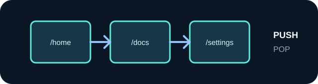

<div align="center">


[](LICENSE)

[](https://github.com/CyberLoop-dev/browser-history-api-lab/stargazers)




</div>

## 🧭 Overview
A local browser playground for the History API. Push and replace same-origin entries, then navigate Back and Forward to observe the `popstate` event and stored state.

## ✨ Features
- ➕ Add entries with `history.pushState()`.
- ♻️ Replace the current entry with `history.replaceState()`.
- ↩️ Navigate with Back and Forward controls.
- 🧾 Inspect `location.pathname`, `history.state`, and event order.
- 🔒 Restricts demo routes to the current origin.

## 🖥️ Demo
Run the local Node.js server; no hosted demo is configured.

## 🚀 Quick Start
```bash
npm start
```
Open `http://127.0.0.1:4173`.

## 🧰 Tech Stack
- Node.js built-in HTTP server
- Browser History API
- Vanilla JavaScript, HTML, and CSS

## 🗂️ Folder Structure
```text
.
├── assets/mark.svg
├── public/app.js
├── public/index.html
├── public/styles.css
├── package.json
├── server.js
└── README.md
```

## 🗺️ Roadmap
- [ ] Add hash-navigation comparison.
- [ ] Add scroll-restoration experiments.
- [ ] Add a route-state serialization example.

## 🤝 Contributing
Keep examples local and same-origin. Include browser version and reproducible navigation steps in bug reports.

## 📄 License
MIT. See [LICENSE](LICENSE).

<div align="center">


</div>
